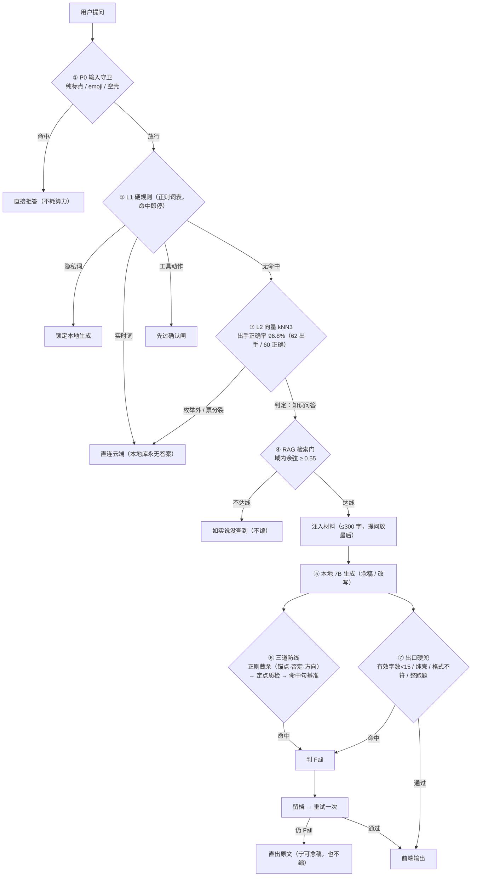

# 案例展示（真实跑批读数）

> **数据来源**：本机真实跑批 —— 本地 7B（`[LocalModelName]`，GGUF `Q4_K_M`，6GB 显存）＋ 知识库材料，
> 30 题 × 5 类生成对照（念稿忠实 / 口语改写 / 数字被改 / 方向说反 / 同域无关）。
> **题干为改写后的示例**（不搬题库原文），**所有比例与余弦值都是实测**。

---

## 一、管线漏斗（一眼看全）

> 漏斗的意义：**能在模型之外拦掉的，全在模型之外拦掉** —— 省算力、也从源头少幻觉；
> 模型只负责"把材料说明白"，**事实由锚点/数字闸管，跑题由语义闸管**。

---

## 二、案例一：域内财会问题 —— 正常交付

| 环节 | 实际内容 |
|---|---|
| **输入** | 「自用房地产转为公允价值模式计量的投资性房地产，转换日公允价值**小于**账面价值的差额计入哪里？」 |
| **① P0** | 通过（非空壳） |
| **② L1** | 无硬规则命中（非隐私、非实时、无工具动作） |
| **③ L2** | 判为 **专业/知识问答**（出手） |
| **④ RAG 门** | 域内命中（余弦 ≥ 0.55）⇒ 注入《企业会计准则》相关条款材料（≤300 字，**提问放在最后**） |
| **⑤ 本地生成** | 念稿式输出，**锚点（科目：公允价值变动损益）逐字保留** |
| **⑥ 三道防线** | 正则截杀：无否定错配、无方向反转、**无新增数字** ⇒ 通过 |
| **⑦ 出口硬兜** | 剥壳后有效字数 ≫ 15、非纯壳、格式符 ⇒ **PASS** |
| **交付** | 直接给前端（**契约头 `<<答>>` 已剥除**） |

**实测读数**（该类的整体分布）：念稿忠实类 `cos(材料,答案)` **中位 0.716**（范围 0.351–0.908），
`answer_guard` 通过 **15/30**；被拦的多为"只念了一部分"（`semantic_sim`）——即**答得不全**，宁可重试。

---

## 三、案例二：数字被改 —— 语义看不出，数字闸拦下

| 环节 | 实际内容 |
|---|---|
| **输入** | 「应收账款账面余额 **1000 万元**、已计提坏账准备 **100 万元**，公允价值 **900 万元**……重组日影响损益多少？」（示例数字） |
| **④ RAG 门 / ⑤ 生成** | 材料注入正常，本地生成流畅、**读起来完全像对的** ⇒ 把"100 万"写成"**1000 万**" |
| **⑥ 三道防线 · 语义闸** | `cos(材料,答案)` = **0.95** ⇒ **语义上"几乎一模一样"，判据完全看不出来** ⚠️ |
| **⑥ · 数字闸** | 抽数比对：答案里的数字**不在材料/问题里、也不可由其推导** ⇒ **命中 `number_consistency` ⇒ Fail** ✓ |
| **动作** | 留档（含 `fail_tags`）→ **重试一次** → 仍 Fail ⇒ **直出原文**，前端绝不出现改过的数字 |

**实测读数**（30 条"数字被改"）：

| 指标 | 值 |
|---|---|
| `cos(材料,答案)` | 最小 **0.921** / 中位 **0.952** / 最大 **0.990** |
| 语义闸放行 | **0 / 30**（它一条都看不出）|
| **数字闸拦下** | **30 / 30** ✓ |
| 结论 | **语义相似度 ≠ 事实正确** ⇒ 事实错必须交给锚点/数字闸 |

---

## 四、实测：五类样本的"语义相似度 vs 事实判据"

| 类别 | n | `cos` 中位（范围） | 语义闸放行 | 主要拦截原因 |
|---|---|---|---|---|
| 正例 · 念稿忠实 | 30 | 0.716（0.351–0.908） | 15/30 | `semantic_sim`（念得不全） |
| 正例 · 口语改写 | 30 | 0.685（0.336–0.848） | 14/30 | `semantic_sim`（同上） |
| 反例 · 数字被改 | 30 | **0.952（0.921–0.990）** | **0/30** | **`number_consistency` 30/30** ✓ |
| 反例 · 同域无关 | 30 | 0.605（0.409–0.720） | **0/30** | `number_consistency` 28、`semantic_sim` 2 |
| ⚠️ 反例 · 方向说反 | 30 | 0.602（0.328–**0.874**） | **14/30** | `semantic_sim` 16 ⇒ **已知盲区** |

---

## 五、从这两个案例能看出什么

1. **入口拦得住的事，别交给模型**（P0 / L1 / 确认闸）——它们零算力、零幻觉。
2. **语义判据管"跑没跑题"，不管"事实对不对"**：数字被改时余弦高达 0.95 ⇒ 必须靠**锚点 + 数字闸**（本项目把**计算也交给 Python**）。
3. **答得"不全"和答得"不对"要分开处理**：前者多是格式/服从问题（重试、降级、最终交 LoRA），后者是红线（必拦）。
4. **已知盲区照实写出来**：「方向说反」（资产说成负债、借说成贷）语义与数字都不动 ⇒ 现阶段靠
   **引用原文直出降级**兜底，根治要等更强的判据或模型微调 —— 这一条在 `README` 与设计文档里都标着，**不藏**。
