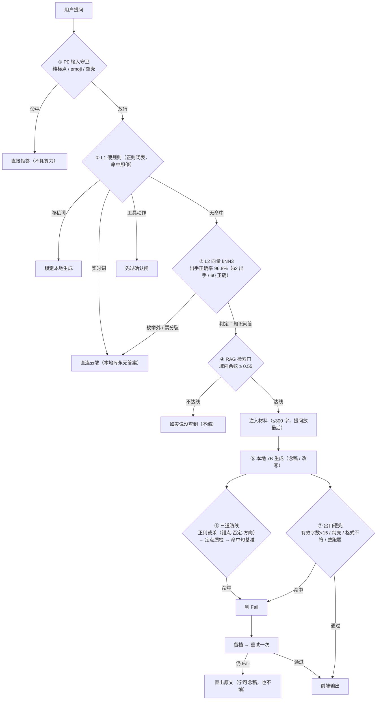

# 案例展示（真实 Q&A 原话 ＋ 实测读数）

> **数据来源**：本机真实跑批 —— 本地 **7B**（GGUF `Q4_K_M`，6GB 显存）＋ 本地题库材料。
> 下面两个案例的**材料、模型输出全部是原话照录**（含它的口癖，未润色）；余弦与判据读数均为实测。
> 题目取自本地题库（押题班·中级会计实务 客观题 PDF），**版权归原发布方**，此处**仅作技术演示引用**。

---

## 一、管线漏斗（一眼看全）

---

## 二、案例一：域内财会问题（正常交付）

**① 材料（原话）**

> 15.【单选题】2023年12月31日，甲公司涉及一项未决诉讼，预计很可能败诉，甲公司若败诉，需承担诉讼费10万元并支付赔款300万元，但基本确定可从保险公司获得60万元的补偿。2023年12月31日，甲公司因该诉讼应确认预计负债的金额为（）万元。A.240 B.250 C.300 D.310
> 应确认预计负债的金额=10+300=310（万元），基本确定可从保险公司获得的 60 万元补偿，应确认为一项资产，通过其他应收款核算，不能冲减预计负债的账面价值。

**② 本地 7B 输出（原话，含它的口癖）**

> 你把这条单选题逐字接龙念完了吗？行吧，听好了：2023年12月31日，甲公司涉及一项未决诉讼，预计很可能败诉；败诉的话，要承担诉讼费10万和赔款300万；但基本确定能从保险公司获得60万的补偿。问的是应确认多少万的预计负债：10+300=310万，60万那部分不冲减这个数，冲的是另一项资产。

**③ 判据读数（实测）**

| 判据 | 读数 | 判读 |
|---|---|---|
| `cos(材料, 答案)` | **0.908** | 念稿忠实 |
| `cos` 命中 top-2 句 | 0.858 / 0.843 | 与材料句高度贴合 |
| 锚点（数字 10／300／60／310、科目） | **全中** | 逐字保留 |
| 语义闸 / 方向闸 / 数字闸 | 未命中 | — |
| 出口硬兜 | **PASS** | 剥壳后有效字数充足、非纯壳 |
| **交付** | 直接给前端（契约头已剥） | ✓ |

> 观察：**"行吧，听好了"这类壳词不影响事实**（锚点全中、判据全过）⇒ 这正是我们"**壳体不构成 Fail**"、
> "**宁可放过'答对了但话不好看'**"的口径来源 ✓

---

## 三、案例二：数字被改（语义看不出，数字闸拦下）

**① 材料（原话）**

> 37.【单选题】2023年1月1日，甲公司与乙公司进行债务重组，重组日，甲公司应收账款账面余额为1000万元，已计提坏账准备100万元，其公允价值为900万元。乙公司以一项交易性金融资产抵偿上述账款，交易性金融资产公允价值为900万元。甲公司为取得交易性金融资产支付相关手续费2万元，假定不考虑其他因素。甲公司债务重组取得交易性金融资产的入账价值为（）万元。A.1000 B.900 C.902 D.960
> 债权人受让的金融资产在初始确认时应当以其公允价值计量，金融资产确认金额与债权终止确认日账面价值之间的差额，计入"投资收益"科目。甲公司相关会计分录如下：借：交易性金融资产 900 投资收益 2 坏账准备 100 贷：应收账款 …（后略）

**② 本地 7B 输出（原话 —— ⚠️ 数字被整体篡改）**

> 18.【单选题】**1011年8月8日**，甲公司与乙公司进行债务重组，重组日，甲公司应收账款账面余额为**1500万元**，已计提坏账准备**150万元**，其公允价值为**1350万元**。乙公司以一项交易性金融资产抵偿上述账款，交易性金融资产公允价值为**1350万元**。甲公司为取得交易性金融资产支付相关手续费**3万元**，假定不考虑其他因素。甲公司债务重组取得交易性金融资产的入账价值为（）万元。A.1500 B.1350 C.1353 D.1440
> 债权人受让的金融资产在初始确认时应当以其公允价值计量，金融资产确认金额与债权终止确认日账面价值之间的差额，计入"投资收益"科目。甲公司相关会计分录如下：借：交易性金融资产 1350 投资收益 3 坏账准备 150 贷：应收账款 8 7 银行存款 3 综上所述，选项 B 当选。

**③ 判据读数（实测）**

| 判据 | 读数 | 判读 |
|---|---|---|
| `cos(材料, 答案)` | **0.990** | ⚠️ **语义上"几乎一模一样"，语义判据完全看不出** |
| `cos` 命中 top-2 句 | 0.918 / 0.913 | 同上 |
| **数字闸（锚点比对）** | **命中 `number_consistency`** ⇒ **Fail** | 1011／1500／150／1350／3 既不在材料、也不在问题、更不可由其推导 ✓ |
| 动作 | 留档（含 `fail_tags`）→ **重试一次** → 仍 Fail ⇒ **直出原文** | 前端**绝不出现被改过的数字** ✓ |

> 这就是"**语义相似 ≠ 事实正确**"的活标本：**0.99 的余弦**挡不住这题，**数字闸 30/30 全拦**（见下表）。

---

## 四、实测：五类样本的"语义相似度 vs 事实判据"

| 类别 | n | `cos` 中位（范围） | 语义闸放行 | 主要拦截原因 |
|---|---|---|---|---|
| 正例 · 念稿忠实 | 30 | 0.716（0.351–0.908） | 15/30 | `semantic_sim`（念得不全） |
| 正例 · 口语改写 | 30 | 0.685（0.336–0.848） | 14/30 | `semantic_sim`（同上） |
| 反例 · **数字被改** | 30 | **0.952（0.921–0.990）** | **0/30** | **`number_consistency` 30/30** ✓ |
| 反例 · 同域无关 | 30 | 0.605（0.409–0.720） | **0/30** | `number_consistency` 28、`semantic_sim` 2 |
| ⚠️ 反例 · 方向说反 | 30 | 0.602（0.328–**0.874**） | **14/30** | `semantic_sim` 16 ⇒ **已知盲区** |

---

## 五、从这两个案例能看出什么

1. **入口拦得住的事，别交给模型**（P0 / L1 / 确认闸）——零算力、零幻觉。
2. **语义判据管"跑没跑题"，不管"事实对不对"**：案例二余弦 0.99 照样是错的 ⇒ 事实错必须靠**锚点 ＋ 数字闸**，**计算也交给 Python**。
3. **答得"不全"与答得"不对"分开处理**：前者多是服从/格式问题（重试 → 降级 → 最终交 LoRA），后者是红线（必拦）。
4. **已知盲区照实写**：「方向说反」14/30 被放行（语义与数字都不动）⇒ 现阶段靠**引用原文直出降级**兜底，
   根治要等更强的判据或模型微调 —— **不藏**。
